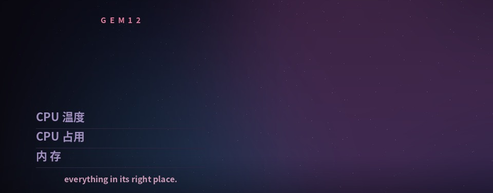

# gem12-subscreen



<sub>Screenshot: *full-bleed* layout. The artwork is third-party fan art used for
demonstration only — it is not part of this project and is not covered by its licence.</sub>

Turn the otherwise unused little display on an **AOOSTAR GEM12** mini-PC into a
personal panel: pick any picture, choose a layout, crop it like a chat avatar,
and push it to the 960 × 376 screen — with live time, date, CPU temperature,
CPU load and memory drawn on top.

The renderer is backend-agnostic. By default it drives
[`zehnm/aoostar-rs`](https://github.com/zehnm/aoostar-rs) (`asterctl`), which
talks to the panel directly; a legacy path for AOOSTAR's own closed-source agent
is included for people already depending on it.

```
┌──────────────────────────── 960 × 376 ─────────────────────────────┐
│  J U S T   M O N I K A                                  ╭────────╮  │
│                                                         │        │  │
│  21:47                                                  │  photo │  │
│  2026/11/05                                             │  card  │  │
│                                                         │        │  │
│  CPU 温度                       57 ℃                    │        │  │
│  CPU 占用                       12 %                    ╰────────╯  │
│  内    存                       43 %                               │
│  今天也辛苦了。                                                     │
└────────────────────────────────────────────────────────────────────┘
```

## Features

- **Three layouts** — rounded photo card on a dark gradient, full-bleed image,
  or an image used as the background *under* the photo card.
- **Avatar-style cropping** — drag to pan, scroll or use the slider to zoom,
  with a live whole-screen preview.
- **WYSIWYG preview** — the preview is produced by the same server-side
  compositor that feeds the panel, so what you see is literally what is sent.
- **Live readouts** — clock, date, CPU temperature, CPU load and memory usage.
- **Rotation** — upload several images and they cycle on a timer.
- **Reboot-safe** — everything runs as systemd units, and the legacy backend
  repairs the two settings the vendor agent gets wrong on a GEM12.
- **Protocol notes included** — the reverse-engineered USB framing is documented
  in [docs/protocol.md](docs/protocol.md), with a tool to decode captured frames.

## Two backends

| backend | how the picture gets there | when to pick it |
|---|---|---|
| **asterctl** (default) | [`aoostar-rs`](https://github.com/zehnm/aoostar-rs) speaks the protocol; this project hands it `bg*.jpg`, `monitor.json` and a small sensor file | you want no vendor binary, no black-screen/rotation workarounds, and the ability to switch the display off |
| **vendor agent** (legacy) | AOOSTAR-X keeps running; panels are POSTed to its web API on `:5123` | you already depend on the vendor software |

Selection happens through `deploy_cmd` in `config.json`: when it is set, the
asterctl path is used and the vendor API is never contacted.

```json
{
  "deploy_cmd": "tar czf - -C \"$GEM12_STAGE\" . | ssh screen-host 'tar xzf - -C /opt/gem12/panels && systemctl restart aster-panel'"
}
```

`$GEM12_STAGE` is the staging directory the web UI rendered into; it is exported
by the app before `deploy_cmd` runs.

## How it fits together

```
┌──────────────┐  HTTP :5124  ┌───────────────┐    deploy_cmd    ┌──────────────────┐
│   browser    │ ───────────▶ │  webui/app.py │ ───────────────▶ │  screen host     │
│ (upload/crop)│              │  (this repo)  │   bg*.jpg +      │  aster-sensors   │
└──────────────┘              └───────────────┘   monitor.json   │  aster-panel     │
                                        │                        └────────┬─────────┘
                                        │ sensor values                   │ USB bulk
                                        └───────────────────────────────▶ │
                                                                 ┌─────────▼─────────┐
                                                                 │   960 × 376 panel │
                                                                 └───────────────────┘
```

`aster-panel` renders the numbers and pushes frames; this project owns the
picture, the layout and the values.

## Install

### 1. Host side — asterctl backend (recommended)

```bash
sudo ./host/install-asterctl.sh            # downloads asterctl + installs two units
cp /path/to/a/CJK-font.ttf /opt/gem12/fonts/   # e.g. HarmonyOS_Sans_SC_Bold.ttf
```

This installs:

- `asterctl` (from the `aoostar-rs` release, checksum-verified) into `/opt/gem12`;
- `aster-sensors.service` — a small Python writer that emits
  `cpu_temperature`, `cpu_percent`, `memory_usage`, `DATE_*` every second;
- `aster-panel.service` — `asterctl` in panel mode; it renders the text on top of
  `bg*.jpg` and only sends the pixels that changed.

### 2. Host side — vendor backend (legacy)

```bash
# extract AOOSTAR-X-linux/ from AOOSTAR's installer first, e.g. to /root/AOOSTAR-X-linux
sudo ./host/install.sh /root/AOOSTAR-X-linux 60
```

This installs `aoostar-x-service.service` plus `gem12-screen-fix.service`, a
one-shot guard ordered **before** the agent that forces `type=2` (GEM12), clears
the built-in panel rotation and mirrors the built-in panels to your custom one.

The agent's own UI then listens on `http://127.0.0.1:5123` (default
`admin` / `123456` — change it).

### 3. Web UI — any machine that can reach the screen host

```bash
python3 -m pip install -r webui/requirements.txt
cp config.example.json config.json     # edit: deploy_cmd, data_dir, header, fonts
python3 webui/app.py                   # http://0.0.0.0:5124
```

If the web UI and the screen live on different machines, point `deploy_cmd` (or
`restart_cmd` for the legacy backend) at the remote host.

## Configuration

`config.json`, or `GEM12_*` environment variables:

| key | default | meaning |
|---|---|---|
| `deploy_cmd` | *(empty)* | shell command that receives `$GEM12_STAGE`; set it to use the asterctl backend |
| `deploy_dir` | `<data_dir>/push` | local staging directory for rendered panels |
| `aoostar_url` | `http://127.0.0.1:5123` | vendor agent API (legacy backend only) |
| `username` / `password` | `admin` / `123456` | vendor agent credentials (legacy backend only) |
| `restart_cmd` | `systemctl restart aoostar-x-service` | run after a push (legacy backend only) |
| `data_dir` | `./data` | uploads, `panels.json`, `defaults.json` |
| `switch_time` | `60` | seconds per panel when rotating |
| `header` | `GEM12` | small letter-spaced label at the top of the panel |
| `fonts` | `[]` | extra font paths, tried before the built-in candidates |

## Usage

1. Drop an image on the start page.
2. Pick a layout: `card`, `full-bleed`, or `bg + card` (the last one also takes a
   separate background image).
3. Drag and zoom until the framing looks right.
4. **Apply to screen** — the panel blanks for a moment while the backend reloads.
5. **Save as default** makes the current panel set what **Restore default**
   returns to.

## Troubleshooting

**asterctl backend**

| symptom | cause | fix |
|---|---|---|
| numbers never change | the sensor file is being rewritten by an old process, or replaced with a new inode (atomic rename), so the watcher goes deaf | run only `aster-sensors.service`; write the file in place |
| no time / date | `asterctl` does not generate `DATE_*` itself | include `DATE_h_m_2` and `DATE_y_m_d_3` in the sensor file |
| CJK labels are boxes | no CJK font in `--font-dir` | copy a CJK font into `/opt/gem12/fonts/` |
| `fontColor` parse error | asterctl expects `#rrggbb` strings, not ARGB integers | use hex strings in `monitor.json` |
| panel black | backend not running | `systemctl status aster-panel; journalctl -u aster-panel -n 30` |

**Vendor backend (legacy)**

| symptom | cause | fix |
|---|---|---|
| panel stays black | the agent thinks it is a WTR MAX (`type=1`) | `fix_config.py` sets `type=2` |
| keeps jumping back to the vendor dashboard | `mianban` rotation list is still populated, and the 8 built-in `diy` panels are still the vendor's | the guard clears `mianban` and rewrites `diy` |
| a new image does not appear | the agent caches panels at start-up | restart it |
| image shifted or garbled after many pushes | the agent is in a bad state | restart it; the repaint is clean |

## Built on

The panel protocol is implemented by
**[zehnm/aoostar-rs](https://github.com/zehnm/aoostar-rs)** (MIT/Apache-2.0).
This project uses it as the backend: we render the picture and feed it sensor
values, `asterctl` handles the USB side. Thanks to Markus Zehnder for the
reverse engineering — without it the screen would still be locked to a
closed-source binary.

The dashboard in
**[marianvid/gem12-dashboard](https://github.com/marianvid/gem12-dashboard)**
is a good example of pushing the same hardware further (touch control, storage
health).

## Assets and licence

- No vendor binaries, fonts or game artwork are included — bring your own images.
- Code is MIT licensed; see [LICENSE](LICENSE).
- AOOSTAR-X is AOOSTAR's software. If you publish screenshots containing
  characters you do not own, respect the rights holder's fan-work guidelines.

---

## 中文说明

把 AOOSTAR GEM12 机箱正面那块「没什么用」的 960 × 376 小屏，变成自己的副屏：
选一张图 → 选版式 → 像换头像一样拖动、缩放、裁切 → 上屏，左上角实时显示时间、
日期、CPU 温度、CPU 占用和内存。

### 三种版式

| 版式 | 说明 |
|---|---|
| 照片框 | 深色渐变底 + 右侧圆角照片 |
| 整屏铺满 | 图片铺满整块屏，左侧自动压暗，保证文字可读 |
| 背景 + 照片框 | 背景图单独上传，前景照片框叠在上面 |

### 两种后端

渲染逻辑和「怎么送到屏上」是分开的：

| 后端 | 原理 | 适用 |
|---|---|---|
| **asterctl**（默认） | 由 [aoostar-rs](https://github.com/zehnm/aoostar-rs) 直接说协议；本项目只提供 `bg*.jpg`、`monitor.json` 和一个小传感器文件 | 不想装厂商闭源软件，也不需要绕 `type` / `mianban` 的坑 |
| 厂商代理（legacy） | AOOSTAR-X 继续运行，本项目通过 `:5123` 的 Web API 推面板 | 已经在用厂商软件的人 |

在 `config.json` 里配置 `deploy_cmd` 即走 asterctl；不配置则回落到厂商接口。

### 安装

```bash
# 1) 屏幕所在的机器（宿主，推荐 asterctl）
sudo ./host/install-asterctl.sh
cp 某个中文字体.ttf /opt/gem12/fonts/

# 2) 任意一台能访问宿主的机器（Web 界面）
pip install -r webui/requirements.txt
cp config.example.json config.json    # 填 deploy_cmd / data_dir / header
python3 webui/app.py                  # http://0.0.0.0:5124
```

**中文字体**：`apt install fonts-noto-cjk`，或把字体放进 `/opt/gem12/fonts/`、
在 `config.json` 的 `fonts` 里指定路径，否则中文会变成方块。

**厂商后端（legacy）**：`sudo ./host/install.sh /root/AOOSTAR-X-linux 60`
会顺带装上 `gem12-screen-fix.service`，开机时修正两个厂商 bug：
把机型设成 `type=2`（否则黑屏）、清空 `mianban` 轮播（否则会跳回自带看板）。

**本仓库不包含**：AOOSTAR 的任何二进制或字体、任何游戏素材。
协议细节见 [docs/protocol.md](docs/protocol.md)。
